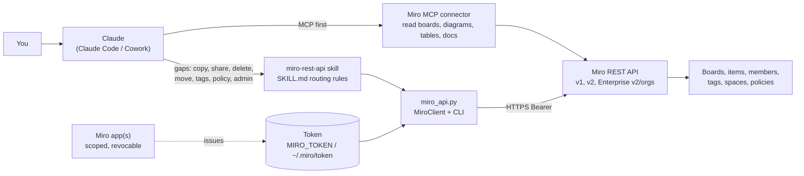
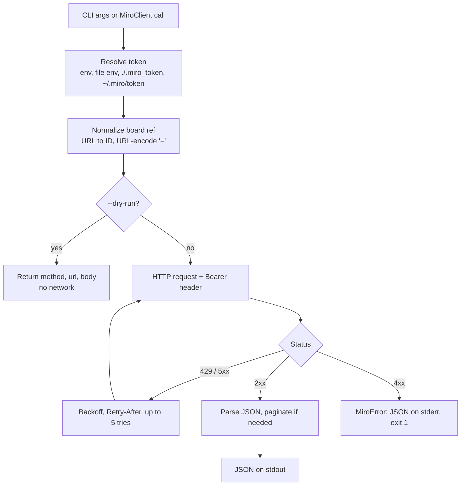
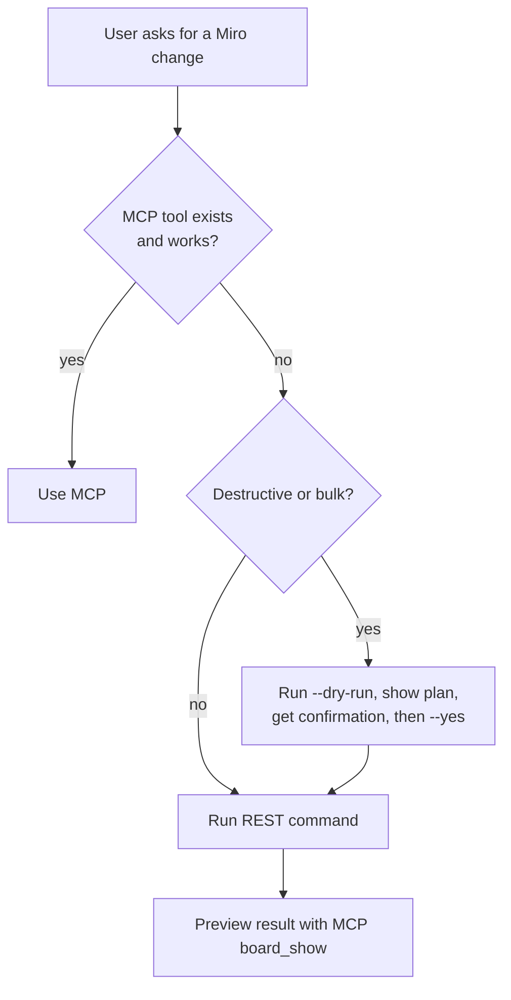
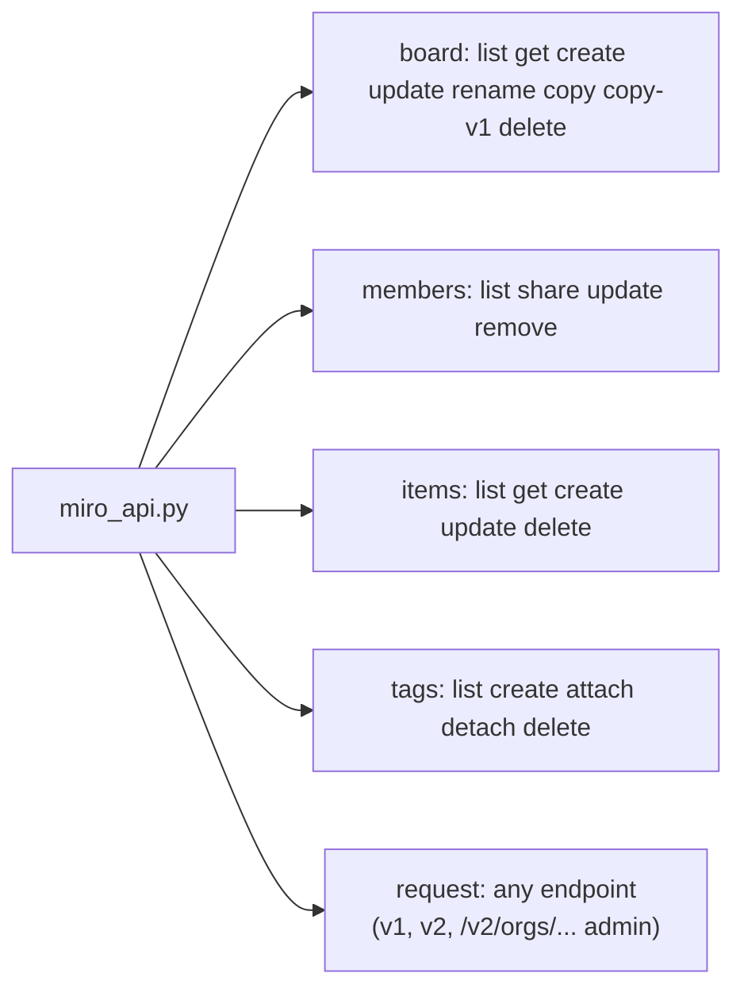
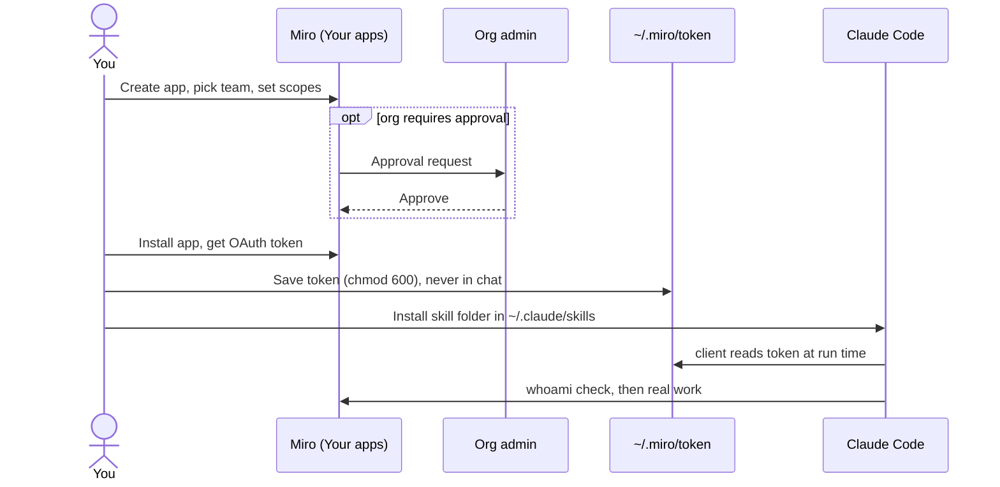

# Architecture

GitHub renders the Mermaid diagrams below natively.

## 1. Where the client sits

## 2. Request pipeline inside the client

## 3. Routing decision

## 4. Capability map

## 5. Setup flow

